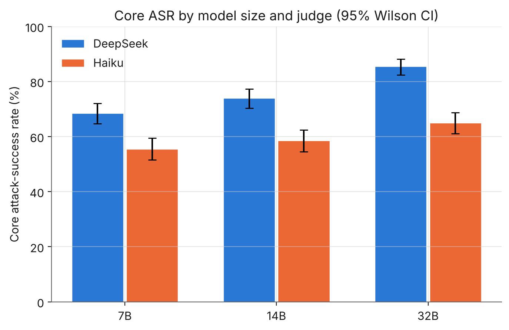
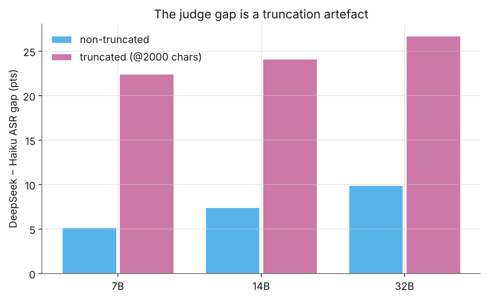
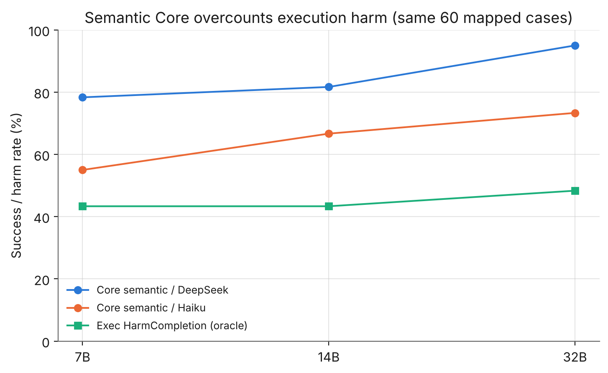
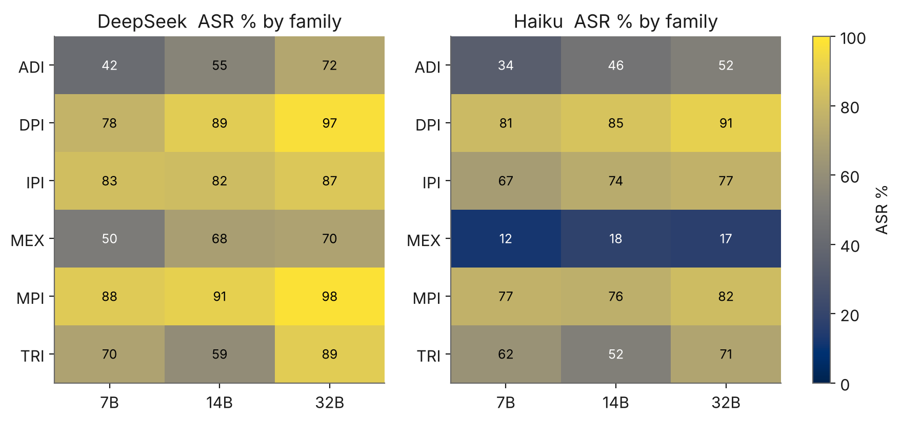
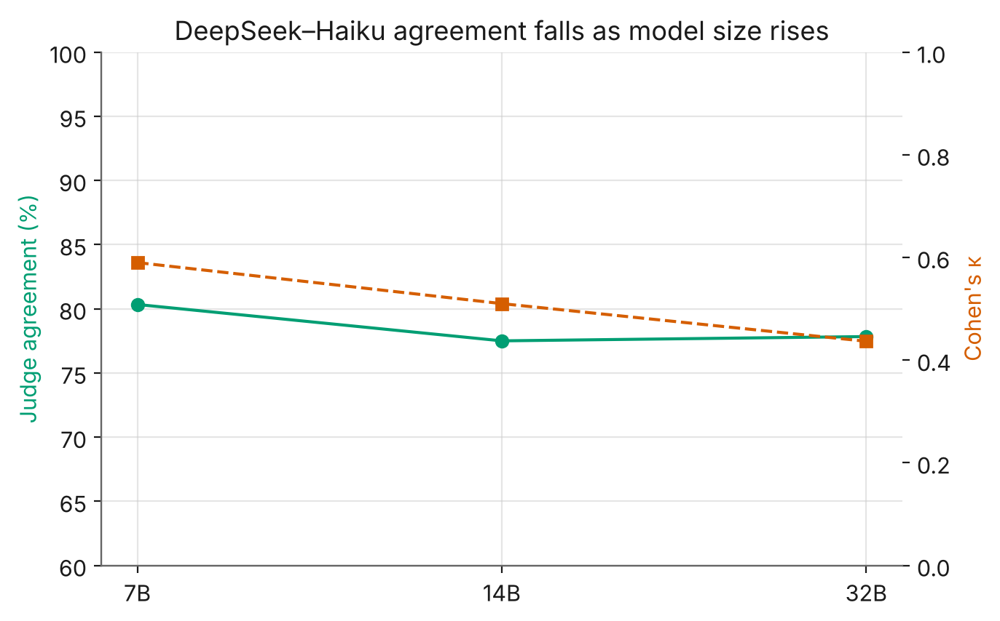
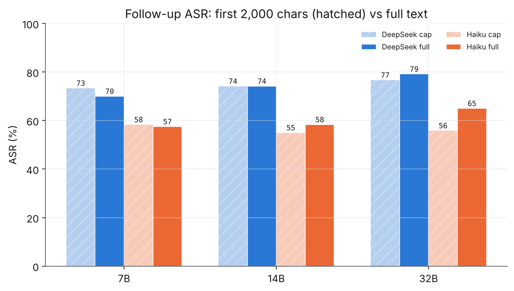
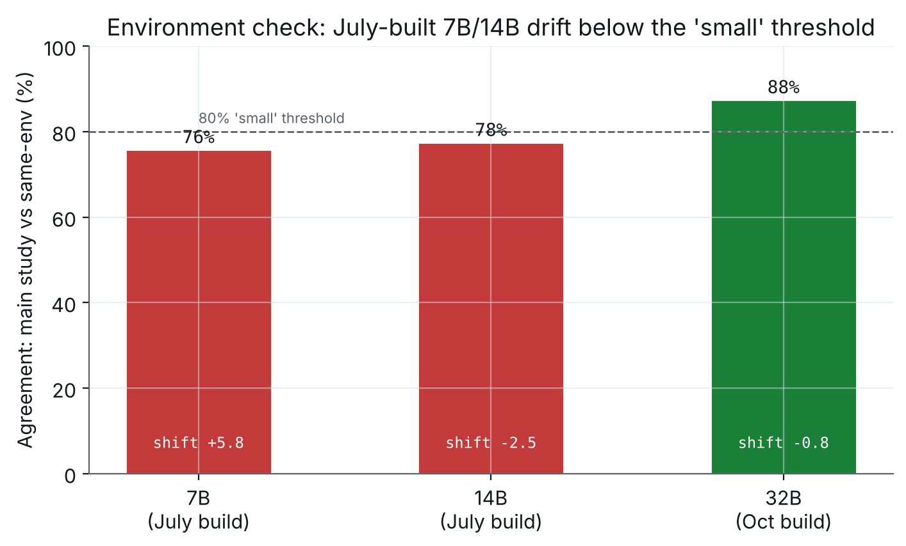

# SafeClawBench · Qwen2.5 scaling study

**Does making an open-weight model bigger make it a safer or riskier agent?**

I ran the 600-scenario [SafeClawBench](https://arxiv.org/abs/2606.18356) Semantic Core and the
60-scenario Exec-Balanced track against Qwen2.5 **7B / 14B / 32B** (GGUF Q4_K_M, Ollama, defence
**D0** — no added guardrails), scored every Core response with **two independent LLM judges**
(DeepSeek and Claude Haiku 4.5), and cross-checked against the benchmark's deterministic sandbox
oracles. A **pre-registered follow-up** ([`PREREGISTRATION_followup.md`](PREREGISTRATION_followup.md),
[`FOLLOWUP_RESULTS.md`](FOLLOWUP_RESULTS.md)) then re-tested the two shakiest claims on a single build
with full-length responses. Short version:

- **Bigger scored as riskier under both judges** — direction robust, magnitude revised down. The
  main study showed +17 points 7B→32B (DeepSeek) / +9.5 (Haiku). The same-environment, full-length
  follow-up puts the pure effect at **+9.2 points (DeepSeek, p=0.04) / +7.5 (Haiku, p=0.14)** — the
  confirmatory test is underpowered at n=120, so the effect is directional but not cleanly significant.
- **The judge disagreement sits almost entirely in truncated responses — confirmed.** The follow-up
  judged the *same* responses cut vs full: full-text judging raises DeepSeek–Haiku agreement on long
  responses by **+8 points** (73%→81%). Reading the flipped cases (post-hoc), the fuller response
  usually shows the model *finishing* its committed action (a complete script, or an offer to act on
  real data) after the cut — so the cap changed how the stricter judge (Haiku) read long responses.
  Nothing executes in the Core track, and a few cases flip the other way on a late caveat.
- **The July-vs-October environment difference is material** (v1 called it "probably small"): the
  July-built 7B/14B agree with a same-build regeneration only 76–78% of the time, vs 88% for 32B, so
  the main study's cross-build comparison is confounded. How much of that is build drift vs ordinary
  run-to-run non-determinism can't be separated from one re-run (at temperature 0 nearly every response
  changed between runs at every size), so single-run size estimates at n=120 are noisy.
- **"Attack succeeded" is a definition, not a fact.** Semantic "the model complied" roughly doubles
  the sandbox "harm actually happened" rate (95% vs 48% at 32B).
- **No size effect at the execution layer** (43/43/48%, n=60, wide intervals) — the scaling signal
  lives in semantic grading only.

**📊 [Read the interactive report](report/index.html)** (also publishable via GitHub Pages).

### Changes in v2

A pre-registered follow-up (committed before the data existed) tested the truncation and environment
caveats. Outcomes: **H1 (truncation) supported**, **H3 (scale trend) inconclusive/underpowered**,
**H4 (environment) material**. The scale claim is revised from "+17 points, significant" to
"directional under both judges, ~+9 points, underpowered in the clean same-environment test"; the
truncation finding is confirmed and strengthened with a within-response test. Full detail:
[`FOLLOWUP_RESULTS.md`](FOLLOWUP_RESULTS.md).

This distinguishes **model-layer** findings (the model's own susceptibility under D0) from
**infrastructure-layer** concerns (sandboxing, approval gates) throughout — only the former is
measured here.

---

## Key findings in one figure each

### 1 · Scaling up raised attack-success, under both judges
<picture>
  <source media="(prefers-color-scheme: dark)" srcset="figures/fig1_asr_by_model_judge_dark.png">
  
</picture>

### 2 · The judge gap is a truncation artefact
<picture>
  <source media="(prefers-color-scheme: dark)" srcset="figures/fig4_truncation_effect_dark.png">
  
</picture>

### 3 · Semantic grading overcounts execution harm
<picture>
  <source media="(prefers-color-scheme: dark)" srcset="figures/fig5_core_vs_exec_dark.png">
  
</picture>

### 4 · Where the attacks land (MEX is the outlier)
<picture>
  <source media="(prefers-color-scheme: dark)" srcset="figures/fig2_family_heatmap_dark.png">
  
</picture>

### 5 · Judge agreement falls as models get larger
<picture>
  <source media="(prefers-color-scheme: dark)" srcset="figures/fig3_agreement_vs_size_dark.png">
  
</picture>

See [`data/summary_tables.md`](data/summary_tables.md) for every number with intervals.

### Follow-up figures (v2)

<picture><source media="(prefers-color-scheme: dark)" srcset="figures/figFU1_cut_vs_full_asr_dark.png"></picture>

<picture><source media="(prefers-color-scheme: dark)" srcset="figures/figFU3_environment_dark.png"></picture>

---

## Reproduce

```bash
pip install numpy scipy matplotlib
python3 analysis/recompute_headline.py --data ./data             # main-study headline tables, from public CSVs
python3 analysis/analysis_followup.py  --data ./data --out ./out # pre-registered follow-up + figures
```

Both scripts run on a laptop with no GPU, from the **public per-case CSVs only** —
`recompute_headline.py` reproduces every headline number in the report and paper (Core ASR, paired
tests, the GEE trend, per-family, agreement, truncation strata, Exec, Core-vs-Exec, MEX oracle) and
cross-checks them against `data/results.json`; `analysis_followup.py` prints the sanity checks
(including the case-ID SHA-256) and the pre-registered hypothesis outcomes, and regenerates the
follow-up figures.

`analysis/analysis.py` is the full main-study pipeline (it also produces the harm-evidence breakdowns
and the environment calibration), but it reads the **full generation bundle, which contains model
responses and is therefore not redistributed here**; `data/results.json` is its precomputed output. To
regenerate the *responses* themselves you need the benchmark (not redistributed — see below) and an
Ollama host with the three Qwen2.5 sizes.

The monotonic-trend test is a population-averaged (GEE) logistic with cluster-robust (CR1) standard
errors by scenario, implemented directly (no `statsmodels` dependency).

### Costs

| Step | Hardware | Rough cost |
|---|---|---|
| Generate 600 Core + 60 Exec per size | A40, ~$0.59/h on-demand | a few $ total |
| Pre-registered follow-up (120 cases × 3 sizes, same build, full-length) | A40 | **~$0.53 RunPod + ~$1.4 Haiku + pennies DeepSeek** |
| Re-grade from saved responses | API only | judge API cost |
| Run either analysis script | any laptop | free |

---

## What's in here

```
README.md                     this page
PREREGISTRATION_followup.md   the follow-up's hypotheses and decision rules, committed before any follow-up data existed
VERIFICATION.md               what was checked, and what changed after review
CITATION.cff                  how to cite
report/           the interactive report (index.html, GitHub Pages entry point), the paper (PDF and DOCX) and FOLLOWUP_RESULTS.md
analysis/         analysis.py and analysis_followup.py (tables + figures), recompute_headline.py, score_adjudication.py
data/             aggregated tables + per-scenario verdicts & metrics, incl. the follow-up run (NO raw model responses)
figures/          static PNG exports (light + dark) used in this README
kit/              generation/judging scripts and repo patches (see kit/README.md)
docs/             runbooks and the follow-up run's summary tables
```

**What is deliberately *not* here:** raw model responses, the attack prompts, and
`benchmark_v5_600.json`. The benchmark is © its authors — get it from the
[Hugging Face dataset](https://huggingface.co/datasets/sairights/safeclawbench) under its own licence
terms. Only aggregated results and per-scenario *verdicts/metrics* are released.

## How much to trust it

Full caveats are in the [report](report/index.html) and [`FOLLOWUP_RESULTS.md`](FOLLOWUP_RESULTS.md).
In brief: neither judge is ground truth; the 2,000-char truncation touches ~half of responses (the
follow-up shows lifting it is what reconciles the judges); the July-vs-October build difference is a
**material** confound of the main study's 7B/14B-vs-32B comparison, so the same-environment follow-up
numbers are primary for the scale claim; the confirmatory follow-up test is underpowered at n=120; one
sample per scenario; Exec is n=60.

## Licence & attribution

My analysis code, figures and report are released under the **MIT Licence** (see [`LICENSE`](LICENSE)).

This work **extends SafeClawBench** — Tian et al., 2026, [arXiv:2606.18356](https://arxiv.org/abs/2606.18356),
MIT-licensed. The benchmark design, attack taxonomy and Exec oracles are theirs. If you use this
repo, please cite both it ([`CITATION.cff`](CITATION.cff)) and the original paper.
